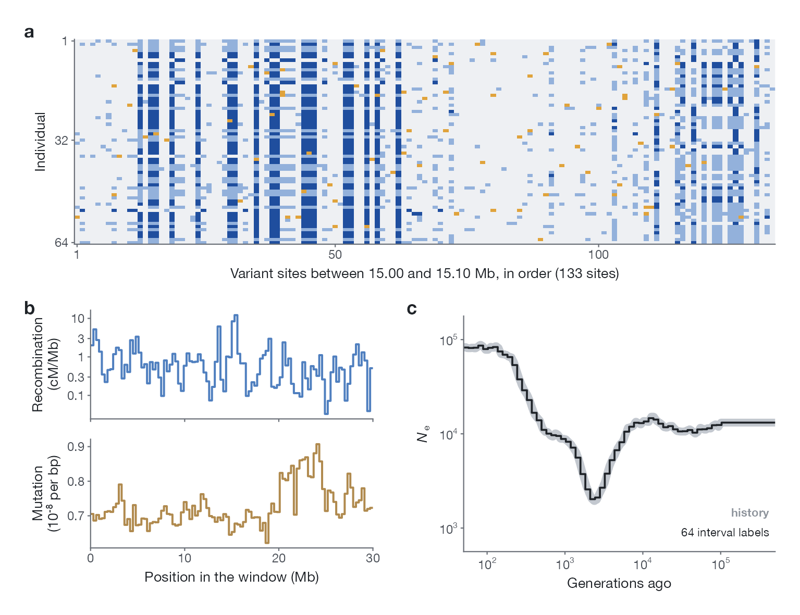

import { Card, CardGrid, LinkCard } from '@astrojs/starlight/components';

<CardGrid>
  <Card title="Input" icon="document">
    Unphased genotypes of 32 diploid individuals in one window of 30 Mb of accessible sequence, with
    the recombination and mutation maps estimated for that window.
  </Card>
  <Card title="Output" icon="rocket">
    log₁₀ Ne on 64 time intervals, evenly spaced in log time from 50 to 500,000
    generations ago.
  </Card>
  <Card title="Training data" icon="puzzle">
    109,248 simulated windows from twelve families of size history, with sequencing-like errors and
    maps that vary along the sequence.
  </Card>
  <Card title="Open" icon="open-book">
    The simulations, the benchmark, the 1000 Genomes analyses and the trained network are on Hugging
    Face under CC BY 4.0. The code is being prepared for release.
  </Card>
</CardGrid>

## One training window

**a**, Genotypes of the 64 individuals of window `sim_00000016` at the 133 variant sites between
15.00 and 15.10 Mb: 0 pale, 1 light blue, 2 dark blue, missing calls orange. **b**, The
recombination and mutation maps stored with the window, averaged in 300-kb bins. **c**, The
simulated history (grey) and its 64 interval labels (black), which are the network's targets.

## Data and network

<CardGrid>
  <LinkCard
    title="Simulated corpus"
    description="109,248 windows of 30 Mb with their true histories, the network's input files and the simulator. 647 GB."
    href="data/simulations/"
  />
  <LinkCard
    title="Benchmark"
    description="33 histories in three settings: the windows, the inputs given to each method, every estimate and the scores. 24 GB."
    href="data/benchmark/"
  />
  <LinkCard
    title="1000 Genomes analyses"
    description="25 populations, 51 windows, four map inputs, and the low-coverage comparison. 196 GB."
    href="data/1000g/"
  />
  <LinkCard
    title="Trained network"
    description="Weights, training record and the networks of the comparisons. 0.8 GB."
    href="model/"
  />
</CardGrid>
