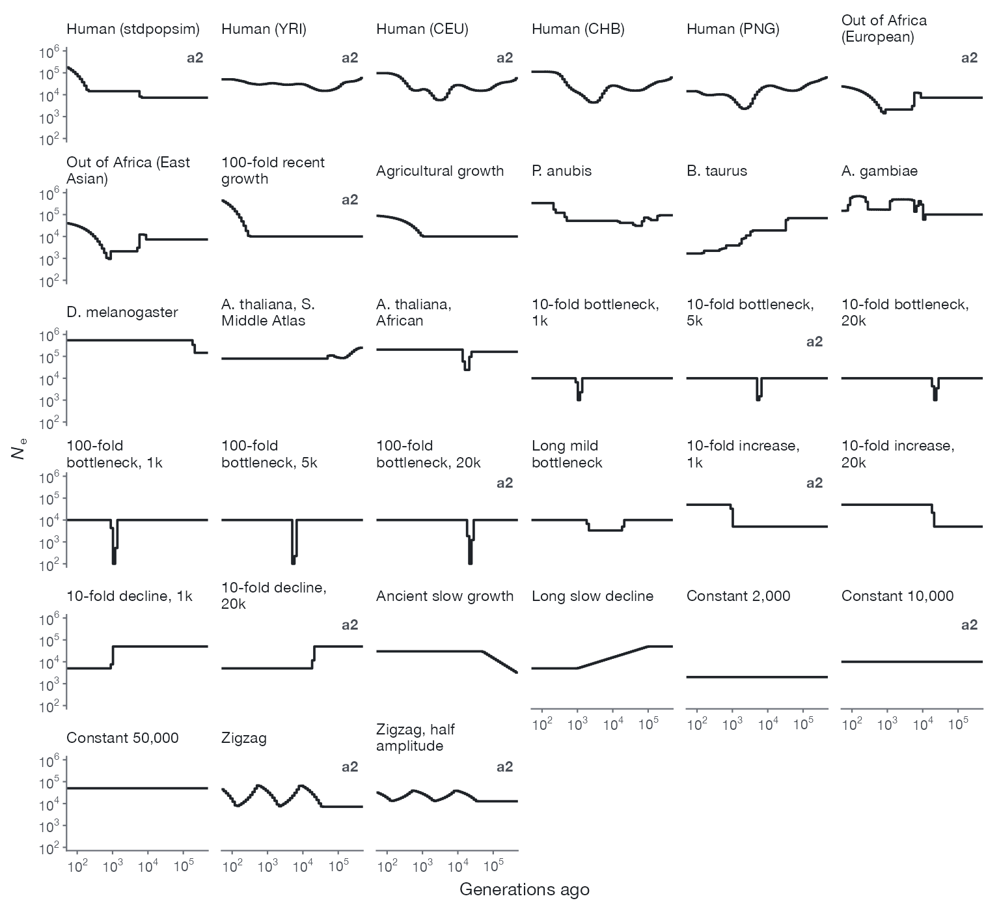

[`Larrivhan/NeCast-benchmark`](https://huggingface.co/datasets/Larrivhan/NeCast-benchmark) 包含真实历史、模拟窗口、给每个方法的原始输入、全部估计、评分、计时实验、8 个窗口的联合拟合，以及 12 个带群体结构的场景。

**33 条历史**，画的是每个方法评分时对照的 64 区间曲线，按类别排列：人类及其他现实模型、瓶颈、阶跃和缓慢变化、恒定大小、振荡。标有 a2 的 12 条也属于设置 `a2`；33 条全部属于 `a1` 和 `b`。

## 三种设置

所有窗口都是 30 Mb、64 个二倍体个体，用训练数据的模拟器生成，随机种子与任何训练窗口都不同。每个方法读取每个窗口中同样的 32 个个体。

| 设置 | 历史数 | 速率与图谱 | 误差 | 方法 |
|---|---|---|---|---|
| `a1` | 33 | 均匀，μ = 1.25 × 10⁻⁸，r = 10⁻⁸（每 bp 每代） | 无 | NeCast、phlash、SMC++、FitCoal、MSMC2 |
| `a2` | 12 | 同 `a1` | 基因分型错误、缺失、假变异和相位切换错误，水平与训练数据相同 | 同上 |
| `b` | 33 | deCODE 2019 重组图谱和 Roulette 突变图谱的片段 | 同 `a2` | NeCast |

每条历史有 12 个窗口，其中 8 个用于评分。在设置 `b` 中，NeCast 对每个窗口用五种版本的图谱分别运行（`map_variants/`）。

## 内容

| 路径 | 内容 |
|---|---|
| `histories/` | 33 条历史：每条的定义和真实曲线 |
| `windows/{a1,a2,b}/` | 各设置的模拟窗口 |
| `necast_inputs/`、`method_inputs/` | NeCast 读取的输入，以及交给 phlash、SMC++、FitCoal 和 MSMC2 的文件 |
| `estimates/<method>/` | 每一次拟合，含设置和记录 |
| `scores/`、`results/` | 逐窗口评分、每个方法在 64 个区间上的曲线，以及汇总表 |
| `timing/`、`joint_fits/`、`structure/` | 计时实验、8 个窗口的联合拟合、12 个群体结构场景 |

[数据集卡片](https://huggingface.co/datasets/Larrivhan/NeCast-benchmark)给出了各方法的设置和文件布局。
