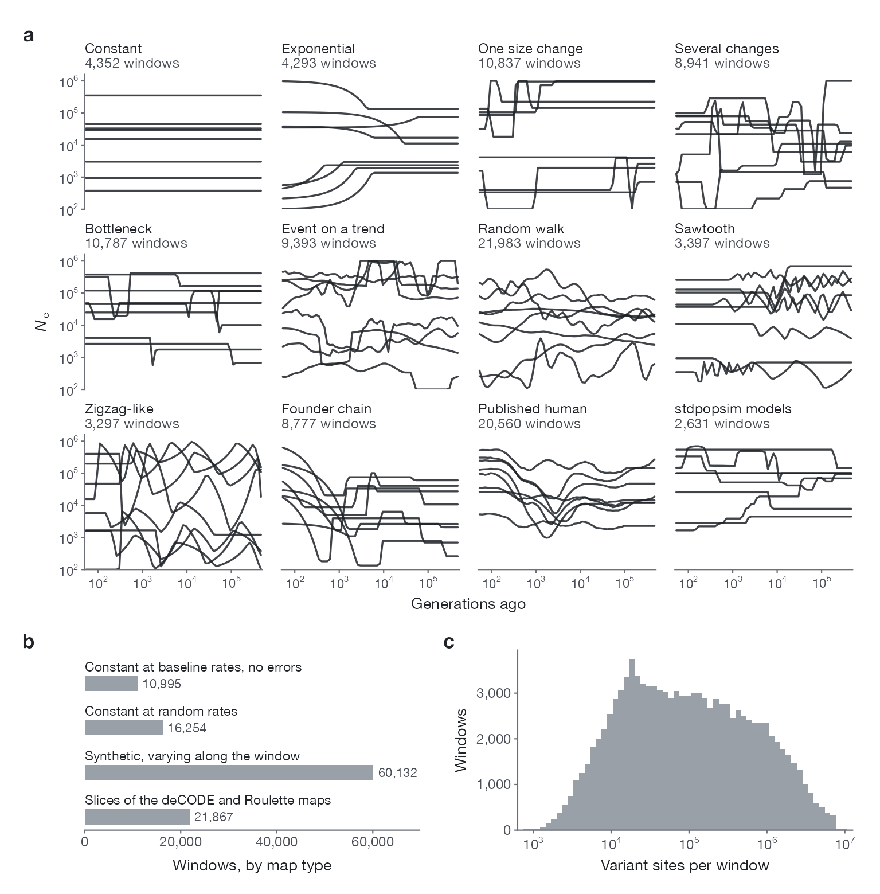

import { Aside } from '@astrojs/starlight/components';

[`Larrivhan/NeCast-simulations`](https://huggingface.co/datasets/Larrivhan/NeCast-simulations) 包含 109,248 个模拟窗口。每个窗口是 64 个二倍体个体的 30 Mb 序列，已经加入了测序误差，并附有真实的群体大小历史。[语料浏览器](../explorer/)可以检索和下载这些窗口。



**a**，从 12 类群体大小历史中各随机抽取 8 个训练窗口，并标出每类的窗口数；每条线是一个窗口的 64 个区间标签，画在区间中点上。**b**，按所附图谱类型统计的窗口数；除基线均匀速率的恒定图谱窗口外，所有窗口都带有测序误差。**c**，每个窗口的变异位点数（含假变异）。

## 怎样模拟

- **序列与样本**：30 Mb，64 个二倍体个体。msprime 1.4.2，带重组的溯祖模型，二态突变模型，使用窗口真实的重组图谱和突变图谱，无基因转换。
- **群体大小历史**：12 个类别，记录在 `generator_recipe`。群体大小限制在 100 到 1,000,000 之间，每条历史的参数都在元数据里。
- **图谱**（`map_type`）：基线均匀速率（`constant_clean`）、随机的恒定速率（`constant_random_global`）、带热点的合成图谱（`synthetic_heterogeneous`），或 deCODE 2019 重组图谱和 Roulette 突变图谱在同一区段的 30 Mb 片段（`empirical_slice`）。窗口附带的图谱就是交给方法的图谱：恒定图谱原样保存，其余图谱保存为加了噪声的真实图谱。
- **误差**（`noise_profile`）：基因分型错误、缺失、假变异和相位切换错误，误差率按窗口抽取。基线均匀速率的窗口不带误差。
- **标签**：`target_log10_ne` 给出 64 个区间上模拟历史 log₁₀ N<sub>e</sub> 的平均值；这些区间在距今 50 到 500,000 代之间按对数时间均匀排列。

| 类别 | `generator_recipe` | 窗口数 |
|---|---|---|
| 恒定 | `constant` | 4,352 |
| 指数变化 | `exponential` | 4,293 |
| 一次大小变化 | `size_event` | 10,837 |
| 多次变化 | `multi_event` | 8,941 |
| 瓶颈 | `bottleneck` | 10,787 |
| 趋势上的事件 | `event_on_background` | 9,393 |
| 谱随机游走 | `spectral_walk` | 21,983 |
| 锯齿 | `sawtooth` | 3,397 |
| 类 Zigzag | `literature_sawtooth` | 3,297 |
| 奠基者链 | `ooa_chain` | 8,777 |
| 已发表的人类历史（SMC++、phlash、MSMC2 和 MSMC-IM 的 191 条估计） | `empirical_human_ne_template` | 20,560 |
| stdpopsim 的 18 个单群体模型 | `stdpopsim_single_pop` | 2,631 |

## 划分

窗口按标识符的哈希值分配：100,000 个训练、5,000 个开发、4,248 个保留；4 个训练窗口没有 PSMC+ 输出，不属于任何划分。最终的网络用 89,996 个训练窗口拟合，另外 500 个训练窗口用来选择训练轮次，500 个开发集窗口作为测试集。`splits/stages.json` 列出了这些窗口。

<Aside>
  4,248 个保留窗口从未用于训练、选择或评估任何网络。它们公开以后，就不能再作为没人用过的测试集。
</Aside>

## 读取一个窗口

```python
from huggingface_hub import hf_hub_download
import sys

repo = "Larrivhan/NeCast-simulations"
path = hf_hub_download(repo, "windows/000/fragment_00000000.npz", repo_type="dataset")
hf_hub_download(repo, "windows/000/fragment_00000000.jsonl.gz", repo_type="dataset")
reader = hf_hub_download(repo, "tools/necast_windows.py", repo_type="dataset")
sys.path.insert(0, reader.rsplit("/", 1)[0])
from necast_windows import Fragment, diploid_genotypes

w = Fragment(path).window(0)
w["genotypes"].shape       # (位点数, 128)：0/1，单倍型 2i 和 2i+1 属于个体 i
g = diploid_genotypes(w)   # (位点数, 64)：0、1、2，缺失为 -1
w["target_log10_ne"]       # 64 个标签
w["metadata"]["generator_recipe"]
```

每个 `.npz` 文件包含 4 个窗口：窗口 `sim_XXXXXXXX` 是 `fragment_{XXXXXXXX div 4}` 中的第 `XXXXXXXX mod 4` 个。[数据集卡片](https://huggingface.co/datasets/Larrivhan/NeCast-simulations)说明了每个数组、网络读取的特征文件和生成程序。
