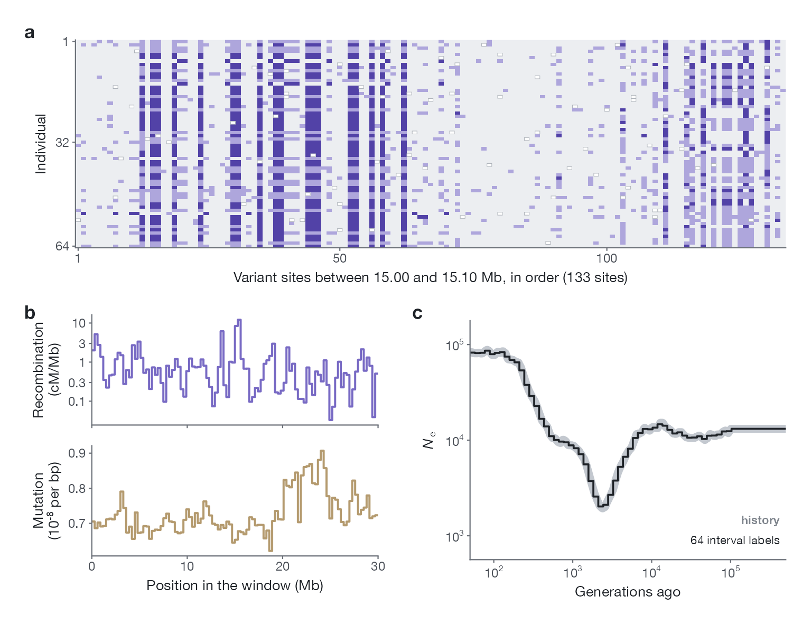

import { Card, CardGrid, LinkCard } from '@astrojs/starlight/components';

<CardGrid>
  <Card title="输入" icon="document">
    一个 30 Mb 可及序列窗口内 32 个二倍体个体的未定相基因型，以及为该窗口估计的重组图谱和突变图谱。
  </Card>
  <Card title="输出" icon="rocket">
    64 个时间区间上的 log₁₀ Ne，区间在距今 50 到 500,000 代之间按对数时间均匀排列。
  </Card>
  <Card title="训练数据" icon="puzzle">
    109,248 个模拟窗口，来自 12 类群体大小历史，带有测序误差，并且图谱沿序列变化。
  </Card>
  <Card title="开放" icon="open-book">
    模拟数据、基准、千人基因组分析和训练好的网络都已在 Hugging Face 上以 CC BY 4.0 协议公开。代码正在整理，随后发布。
  </Card>
</CardGrid>

## 一个训练窗口

**a**，窗口 `sim_00000016` 在 15.00 到 15.10 Mb 之间 133 个变异位点上、64 个个体的基因型：0 为浅色，1 为浅蓝，2 为深蓝，缺失为橙色。**b**，窗口附带的重组图谱和突变图谱，按 300 kb 取平均。**c**，模拟的历史（灰色）及其 64 个区间标签（黑色），即网络的学习目标。

## 数据与网络

<CardGrid>
  <LinkCard title="模拟语料" description="109,248 个 30 Mb 窗口及其真实历史、网络的输入文件和模拟器。647 GB。" href="data/simulations/" />
  <LinkCard title="基准" description="三种设置下的 33 条历史：窗口、给每个方法的输入、全部估计和评分。24 GB。" href="data/benchmark/" />
  <LinkCard title="千人基因组分析" description="25 个人群、51 个窗口、四种图谱输入，以及低深度对比。196 GB。" href="data/1000g/" />
  <LinkCard title="训练好的网络" description="权重、训练记录和对照实验的网络。0.8 GB。" href="model/" />
</CardGrid>
