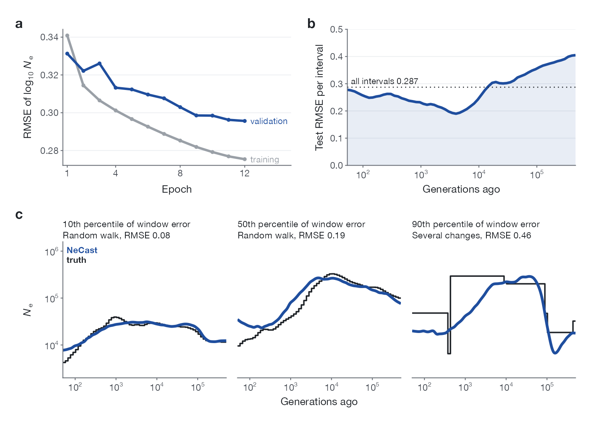

权重发布在 Hugging Face：[`Larrivhan/NeCast`](https://huggingface.co/Larrivhan/NeCast)。

**a**，12 个训练轮次中每一轮结束时的训练误差和验证误差；验证集是另外 500 个训练窗口。**b**，测试误差在 64 个区间上的分布（5 个区间的滑动平均），虚线为所有区间合起来的误差。**c**，单窗口误差处在第 10、50 和 90 百分位的三个测试窗口：真值（黑色阶梯）和 NeCast（蓝色）。

## 文件

| 路径 | 内容 |
|---|---|
| `final/checkpoint.pt` | 论文所用网络的权重（4.2 MB） |
| `final/training_state.pt` | 训练结束时保存的状态 |
| `final/PLAN.json` | 训练配置、输入文件的校验值，以及训练、验证、测试窗口的列表 |
| `final/DEVELOPMENT.json` | 每一轮的训练误差和验证误差 |
| `final/test_predictions.npz` | 500 个测试窗口的预测值和真值 |
| `final/snapshots/` | 第 6 轮和第 9 轮结束时保存的状态 |
| `training_contrasts/` | 用 8,000 或 88,000 个窗口训练的 7 个网络 |
| `ablations/` | 用同样 12,500 个窗口、不同输入训练的 5 个网络 |

`final/checkpoint.pt` 是普通的 PyTorch 文件：`torch.load(path, map_location="cpu", weights_only=True)` 返回一个字典，其中 `state_dict` 是权重。构建输入和运行网络的代码正在整理，随后发布。

## 训练

- **数据**：89,996 个训练窗口；另外 500 个训练窗口用来选择轮次；500 个开发集窗口作为测试集。
- **设置**：在 4 块 RTX 4090 上训练 12 轮（50.3 小时），宽度 128，随机种子 20260728。损失函数是 64 个区间上 log₁₀ Ne 的均方误差。AdamW，学习率 3 × 10⁻⁴，余弦衰减到其 5%，权重衰减 10⁻⁴，梯度范数裁剪为 1，每 32 个窗口更新一次。最后一轮的验证误差最低。
- **测试误差**：0.287，即 500 个测试窗口全部 64 个区间合在一起计算的 log₁₀ Ne 均方根误差。
